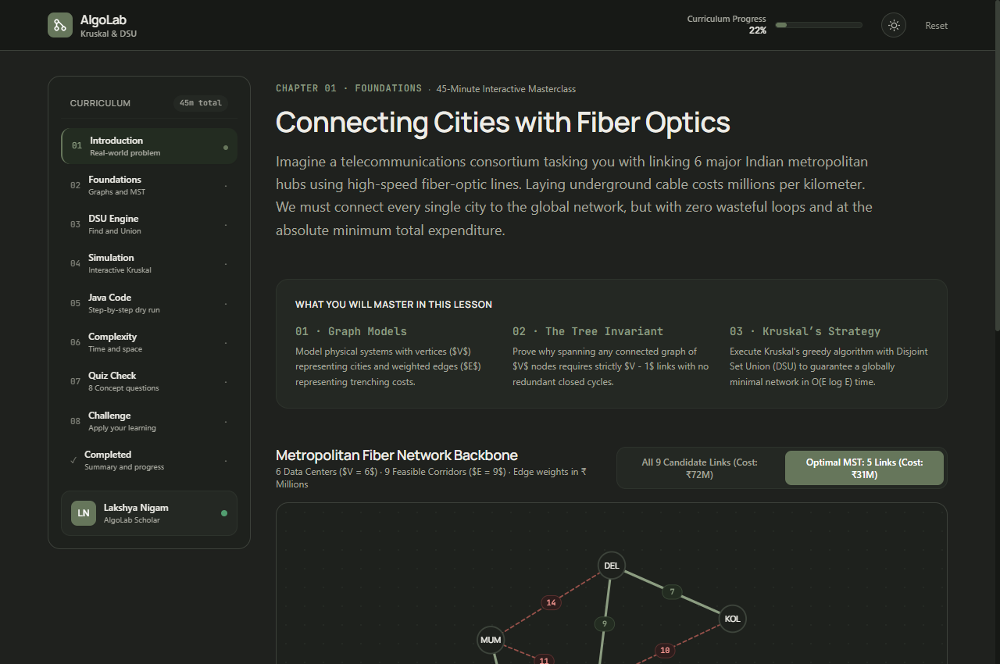
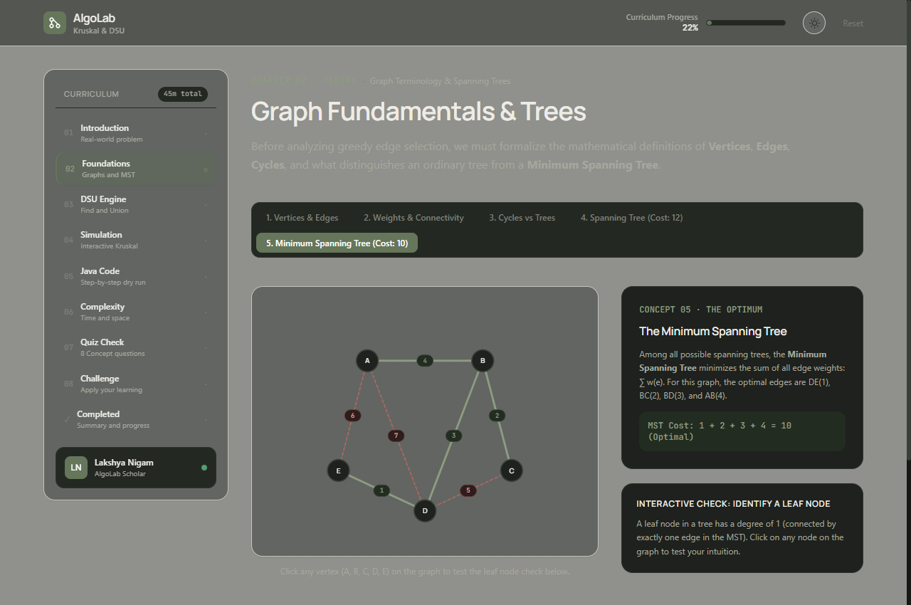
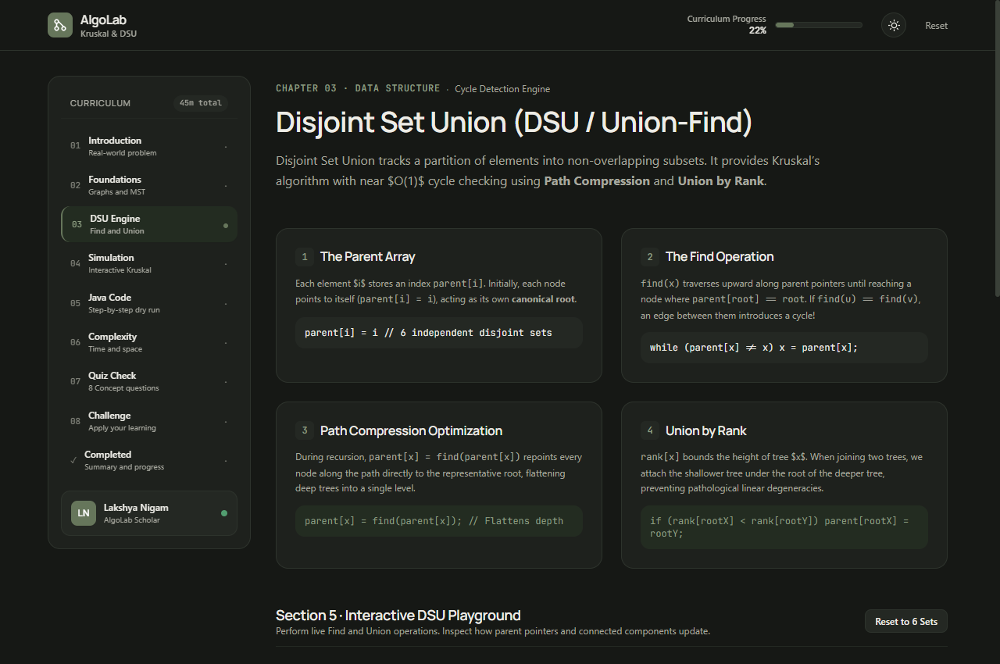
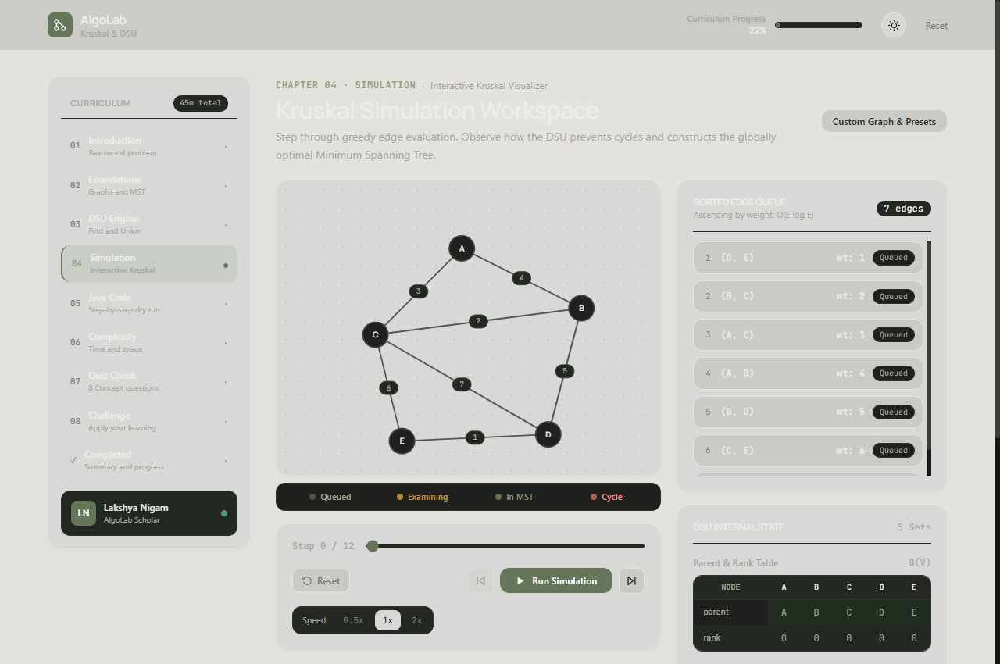
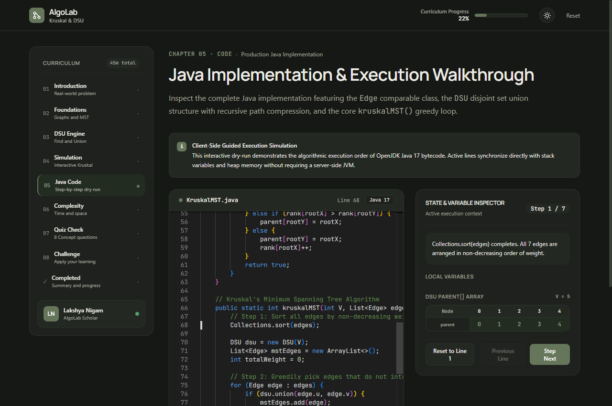
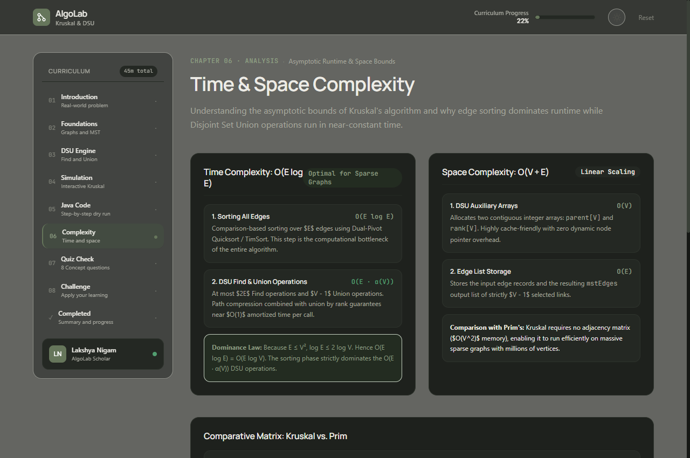
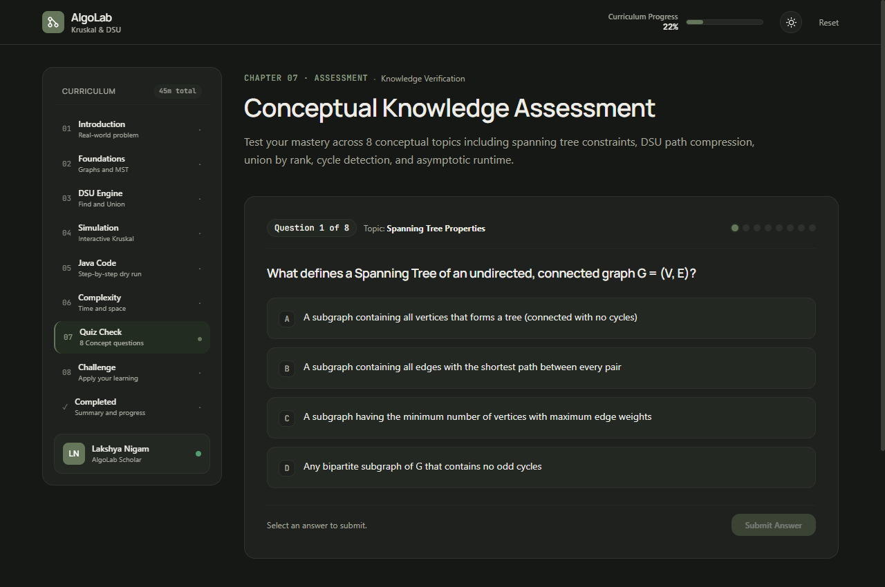
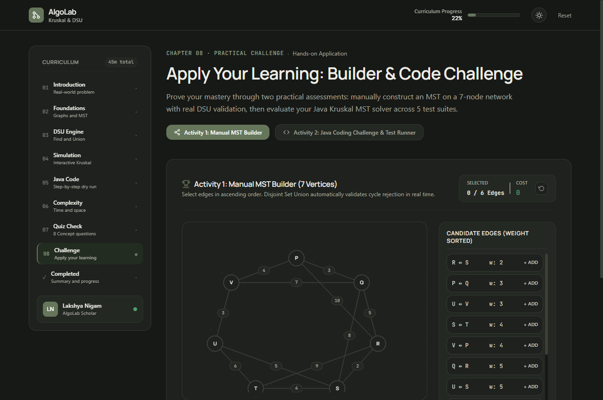
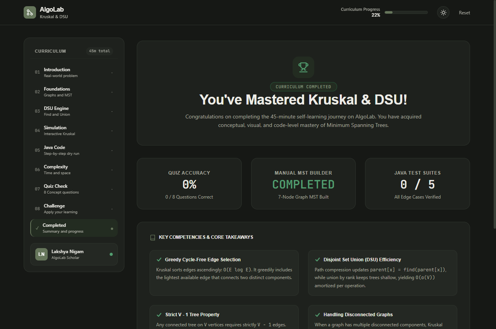

# AlgoLab — Interactive DSA Learning Platform: Kruskal + DSU

> **A 45-Minute Self-Paced Visual Masterclass on Minimum Spanning Trees & Disjoint Set Union**  
> *Developed by Lakshya Nigam for the Kalvium Instructional Designer Intern Assignment*

[](https://react.dev/)
[](https://vitejs.dev/)
[](https://tailwindcss.com/)
[](https://github.com/)

---

## 1. Project Introduction

**AlgoLab** is an interactive, browser-based computer science educational platform designed to bridge the cognitive abstraction gap in graph algorithms. 

### The Problem It Solves
Traditional graph algorithm tutorials rely heavily on static textbook diagrams or passive video walkthroughs. Beginners frequently struggle with:
1. Understanding **why** greedy edge selection works and does not get trapped in local optima.
2. Conceptualizing how **Disjoint Set Union (DSU / Union-Find)** detects cycles without running an expensive graph search ($O(V+E)$ BFS/DFS) on every candidate edge.
3. Translating mathematical and pseudocode definitions into idiomatic, compilable **Java** code.

### Intended Audience
Designed specifically for undergraduate computer science students, bootcamp participants, and software engineering candidates preparing for technical interviews who have fundamental programming familiarity (arrays, loops, classes) but have never previously studied Minimum Spanning Trees or Disjoint Set Union.

---

## 2. Learning Objectives

By completing this self-paced masterclass, learners will:
- **Understand Graph Fundamentals**: Distinguish between weighted/unweighted graphs, cyclic/acyclic networks, and verify tree properties ($V$ vertices, strictly $V - 1$ edges, 0 cycles).
- **Master Minimum Spanning Trees (MST)**: Contrast all-pairs shortest paths (Dijkstra) with total network cost minimization (Kruskal/Prim).
- **Internalize Greedy Strategy**: Grasp the cut property and why non-decreasing edge weight ordering guarantees global optimality.
- **Master Disjoint Set Union (DSU)**:
  - Understand the `parent[]` array representation of disjoint subsets.
  - Implement **Find with Path Compression**, flattening multi-level trees directly to canonical roots in $O(\alpha(V))$ amortized time.
  - Implement **Union by Rank**, preventing pathological linear tree degradation.
- **Simulate Kruskal's Algorithm**: Visually trace candidate edge evaluation, root comparisons, and cycle rejection in real time.
- **Implement in Java**: Read, analyze, and dry-run an idiomatic OpenJDK 17 Java implementation using `Comparable<Edge>`, DSU, and Collections sorting.
- **Analyze Time & Space Complexity**: Understand why sorting dominates the runtime ($O(E \log E)$) and how the Inverse Ackermann function $\alpha(V) \le 4$ renders DSU operations effectively constant time.

---

## 3. Features & Curriculum Breakdown

| Module | Title | Core Interactive Mechanics |
|---|---|---|
| **01** | **Introduction** | Real-world problem: Connecting 6 major cities with fiber optic backbone cable. Interactive ₹72M vs ₹31M cost toggle and 3 Golden Rules of MSTs. |
| **02** | **Foundations** | 5-stage conceptual stepper: Vertices & Edges, Weights & Connectivity, Cycles vs Trees, Spanning Trees, and MSTs. Includes an interactive leaf-node degree tester. |
| **03** | **DSU Engine** | Live memory inspection of `parent[]` and `rank[]` arrays (V = 6). Separated interactive Find (with animated path traces) and Union controls, partition pills, and event audit log. |
| **04** | **Simulation** | Central Kruskal visualizer featuring play/pause/step controls, speed multiplier (0.5x, 1x, 2x), timeline scrubber, ascending edge queue, DSU state table, active learner predictions, and custom graph creator with presets. |
| **05** | **Java Code** | Production Java 17 implementation embedded via Monaco Editor with line-by-line synchronized dry-run highlighting, live local variables, and stopping condition checks. |
| **06** | **Complexity** | Mathematical breakdown of sorting bottleneck ($O(E \log E)$) vs DSU amortized cost ($O(E \cdot \alpha(V))$), Kruskal vs Prim selection matrix, and Inverse Ackermann reference table. |
| **07** | **Assessment** | 8 conceptual multiple-choice questions with single-stepper navigation, immediate feedback, wrong answer explanations, and automated weak concept diagnostics. |
| **08** | **Challenge** | Dual hands-on activities: (1) Manual MST Builder on a 7-node network with live DSU cycle rejection; (2) Java Coding Challenge with Monaco Editor evaluated against 5 automated test suites. |
| **✓** | **Completion** | Performance scorecard tracking quiz accuracy, challenge status, and key architectural competencies with progress reset. |

---

## 4. Visual Design System

AlgoLab follows an editorial, calm, and distraction-free design system:
- **Palette**:
  - Background Canvas: `#F6F5F0` (Dark: `#161815`)
  - Primary Surface: `#FFFFFF` (Dark: `#1E211D`)
  - Secondary Surface: `#EFEEE8` (Dark: `#242823`)
  - Accent Sage: `#66765B` (Dark: `#8C9D81`)
  - Primary Text: `#252720` (Dark: `#EDECE6`)
  - Secondary Text: `#77786F` (Dark: `#A6A79E`)
  - Borders: `#E4E3DC` (Dark: `#2D332C`)
- **Typography**:
  - Headings: `Manrope` (600/700 weight, tight tracking)
  - Body Prose: `DM Sans` (400/500 weight, 1.65 line-height)
  - Code & Metrics: `JetBrains Mono`
- **Iconography**: Bespoke, accessible inline SVGs adhering to WCAG contrast standards.

---

## 5. Technology Stack

- **Frontend Core**: React 19.3 + Vite 8.3
- **Styling**: Tailwind CSS v4.3
- **Routing**: React Router v7.18 (Single Page Application with layout routing)
- **Code Editor**: Monaco Editor (`@monaco-editor/react` v4.7)
- **Vector Graphics**: Native SVG with mathematical coordinate mapping
- **Data Persistence**: Web Storage API (`localStorage`)
- **Testing**: Node.js automated test runner (`test_suite_complete.js`)
- **Backend**: Zero external server dependencies; 100% self-contained client-side algorithms

---

## 6. Project Structure

```
algolab/
├── public/
│   ├── favicon.svg              # SVG brand mark
│   └── _redirects               # SPA fallback routing for Netlify
├── screenshots/                 # Application visual walkthrough
│   ├── 01_introduction.png
│   ├── 02_foundations.png
│   ├── 03_dsu_engine.png
│   ├── 04_kruskal_simulation.png
│   ├── 05_java_walkthrough.png
│   ├── 06_complexity_analysis.png
│   ├── 07_quiz_assessment.png
│   ├── 08_practical_challenge.png
│   └── 09_completion_summary.png
├── src/
│   ├── algorithms/              # Algorithmic business logic
│   │   ├── dsu.js               # Disjoint Set Union class (path compression + rank)
│   │   └── kruskal.js           # Kruskal snapshot generator & cycle detector
│   ├── components/
│   │   ├── code/                # Java Monaco editor viewer & dry-run
│   │   ├── graph/               # Responsive SVG graph component
│   │   ├── layout/              # Header, Sidebar, and AppLayout chrome
│   │   ├── legal/               # Privacy Policy & Terms modal
│   │   ├── quiz/                # Assessment, Manual Builder, & Challenge Runner
│   │   └── visualizer/          # Controls, EdgeQueue, DSUVisualizer, Prediction
│   ├── context/                 # ThemeContext (Light / Dark mode)
│   ├── data/                    # Curriculum data, quiz questions, Java source
│   ├── hooks/                   # useKruskalVisualizer simulation hook
│   ├── pages/                   # 8 Chapter pages + Completion page
│   ├── utils/                   # LocalStorage persistence manager
│   ├── App.jsx                  # Route definitions
│   ├── index.css                # Tailwind design tokens & font imports
│   └── main.jsx                 # React root mount
├── package.json
├── test_suite_complete.js       # 20-test automated verification suite
├── vercel.json                  # SPA fallback routing for Vercel
└── vite.config.js
```

---

## 7. Installation & Local Development

### Prerequisites
- Node.js (version 18.0 or higher recommended)
- npm, pnpm, or yarn

### Steps to Run Locally

1. **Clone the repository:**
   ```bash
   git clone <repository-url>
   cd algolab
   ```

2. **Install dependencies:**
   ```bash
   npm install
   ```

3. **Run the local development server:**
   ```bash
   npm run dev
   ```
   Open `http://localhost:5173/` in your browser.

4. **Execute the automated test suite:**
   ```bash
   npm test
   ```
   Runs 20 automated tests verifying Kruskal edge cases, DSU operations, Java line synchronization, and quiz logic.

5. **Create a production build:**
   ```bash
   npm run build
   ```
   Generates optimized static assets in the `dist/` directory.

---

## 8. Algorithm Explanation & Theory

### Kruskal's Minimum Spanning Tree
Kruskal's algorithm is a greedy algorithm that finds a minimum spanning tree for a connected, weighted, undirected graph:
1. **Sort**: Arrange all $E$ edges in non-decreasing order of weight ($O(E \log E)$).
2. **Initialize DSU**: Place each of the $V$ vertices into its own singleton disjoint set ($O(V)$).
3. **Greedy Selection**: For each edge $(u, v)$ with weight $w$:
   - Run `find(u)` and `find(v)`.
   - If `find(u) != find(v)`: The vertices belong to separate components. Accept the edge into the MST and merge their sets using `union(u, v)`.
   - If `find(u) == find(v)`: The vertices are already connected. Adding this edge would create a cycle; reject the edge.
4. **Early Termination**: As soon as $V - 1$ edges have been accepted, the MST is complete and the loop safely breaks.

### Disjoint Set Union (DSU) Optimizations
- **Path Compression**: During `find(x)`, the algorithm repoints every traversed node directly to the set's canonical root:
  $$\text{parent}[x] = \text{find}(\text{parent}[x])$$
- **Union by Rank**: During `union(x, y)`, the tree with smaller depth (rank) is attached beneath the root of the tree with greater depth. Rank increments only when two equal-rank trees are merged.
- **Combined Complexity**: Any sequence of $M$ operations on $N$ elements takes $O(M \cdot \alpha(N))$ time, where $\alpha$ is the Inverse Ackermann function ($\alpha(N) \le 4$ for all practical universe-scale values of $N$).

---

## 9. Visual Walkthrough & Screenshots

### 01. Chapter 01 · Real-World Fiber Optic Problem


### 02. Chapter 02 · Graph Foundations & Leaf-Node Intuition


### 03. Chapter 03 · Disjoint Set Union (DSU) Live Memory & Playground


### 04. Chapter 04 · Kruskal Interactive Simulation Workspace


### 05. Chapter 05 · Java 17 Monaco Editor Walkthrough & Dry-Run


### 06. Chapter 06 · Asymptotic Complexity & Ackermann Analysis


### 07. Chapter 07 · Conceptual MCQ Assessment with Diagnostic Feedback


### 08. Chapter 08 · Hands-on Manual MST Builder & Code Challenge


### 09. Chapter 09 · Performance Scorecard & Completion


---

## 10. Known Limitations

1. **Monaco Editor on Mobile Touchscreens**: The VS Code Monaco Editor is optimized for keyboard and pointer interactions. On screens smaller than 400px, code viewing is functional, but heavy code editing is best experienced on tablets or desktops.
2. **Client-Side Algorithmic Emulation**: Java execution in Chapter 05 and Chapter 08 is powered by client-side JavaScript emulation rather than a remote server-side JVM container.
3. **Single Active Simulation Preset**: The custom graph editor currently supports up to 10 vertices and 25 edges for optimal vector performance on low-power mobile devices.

---

## 11. License & Attribution

- **Author**: Lakshya Nigam
- **Project**: AlgoLab Interactive Educational Platform
- **Assignment**: Kalvium Instructional Designer Intern Submission
- **License**: MIT Open Educational Resource
